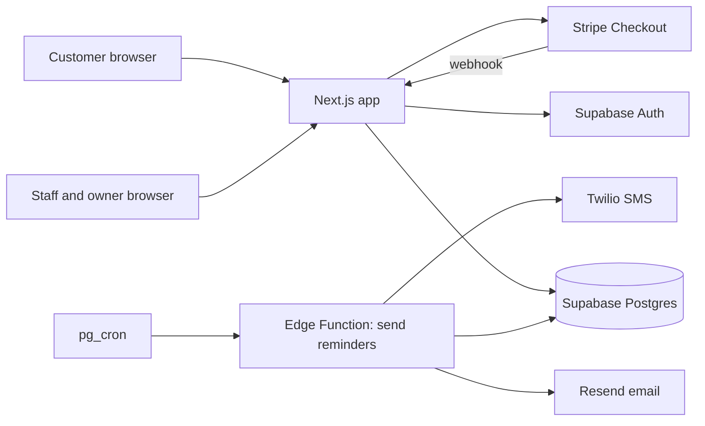
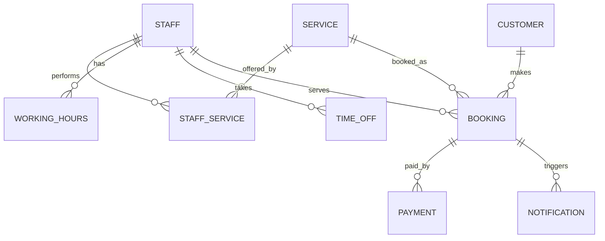

# Architecture

This document describes how the salon booking system is built. Product behaviour is in [DESIGN.md](DESIGN.md). Significant decisions are recorded as ADRs in [docs/adr/](docs/adr/).

## 1. Goals and constraints

- **Scale:** about 100 bookings per week for one salon. Design for roughly 10x that, no further. No need for microservices, queues or caching layers in v1.
- **Correctness first:** a double booking or a lost payment is far worse than a slow page. Enforce invariants in the database, not only in application code.
- **Time zone:** the salon operates in Europe/London. Store all timestamps as `timestamptz` in UTC. Convert to Europe/London only at the display edge. Daylight saving changes must not move bookings.
- **Currency:** GBP. Store money as integer pence, never as floating point.
- **Small team:** one developer plus AI assistance. Prefer boring, well-documented tools over custom infrastructure.
- **Privacy:** customer data is personal data under UK GDPR. Card details never touch our systems.

## 2. Stack

| Concern | Choice | Why |
|---|---|---|
| Web app | Next.js (App Router), TypeScript | Single codebase for the public booking site and the admin area. Server components keep data access on the server. |
| Database | Postgres via Supabase | Relational data with strong constraints. Exclusion constraints prevent double booking. |
| Auth | Supabase Auth | Built in, supports email magic links and staff logins. |
| Authorisation | Postgres row-level security | Enforces who can read or change what, even if application code has a bug. |
| Scheduled jobs | Supabase `pg_cron` calling an Edge Function | Avoids running a separate worker for reminders. |
| Payments | Stripe Checkout | Handles card data and PCI scope. We store only Stripe IDs and status. |
| Email | Resend | Simple API, good deliverability, templates in code. |
| SMS | Twilio | Widely used, UK sender support. |
| Hosting | Vercel (app), Supabase (data) | Preview deployments per branch. Managed backups. |
| Tests | Vitest (unit), Playwright (end to end), pgTAP (database rules) | One tool per layer, all run in CI. |

## 3. System overview

There is one deployable application and one database. The reminder job is the only background process.

## 4. Components

| Component | Responsibility |
|---|---|
| `app/(public)` | Booking flow: choose service, staff, time, details, pay. Manage booking by link. |
| `app/(admin)` | Owner and staff views: calendar, services, staff, hours, reports. |
| `lib/availability` | Pure functions that turn working hours, time off and bookings into free slots. No database access, so it is easy to test. |
| `lib/booking` | Create, reschedule and cancel bookings. Calls the database functions that enforce rules. |
| `lib/payments` | Stripe session creation and webhook handling. Idempotent on Stripe event ID. |
| `lib/notifications` | Message templates and provider adapters for email and SMS. |
| `supabase/migrations` | Forward-only SQL migrations. Source of truth for schema and constraints. |
| `supabase/functions/send-reminders` | Finds due notifications and sends them. |
| `supabase/tests` | pgTAP tests for constraints and row-level security. |

## 5. Data model

All tables have `id uuid primary key`, `created_at timestamptz`, and `updated_at timestamptz`.

| Table | Key fields | Notes |
|---|---|---|
| `service` | name, description, duration_minutes, buffer_minutes, price_pence, payment_mode (`none`, `pay_now`, `pay_in_salon`), active, sort_order | Buffer is time reserved after the service for cleaning and changeover. |
| `staff` | profile_id (nullable, links to auth user), display_name, active | Staff without a login can exist, for example for reporting. |
| `staff_service` | staff_id, service_id | Which staff can perform which service. Composite primary key. |
| `working_hours` | staff_id, weekday (0 to 6), starts_local (time), ends_local (time) | Recurring weekly pattern. Times are local (Europe/London). |
| `time_off` | staff_id, starts_at, ends_at, reason | Holidays, sickness, one-off closures. Stored as timestamptz. |
| `customer` | full_name, email, phone, marketing_consent, auth_user_id (nullable) | Created on first booking. Guests are allowed in v1. |
| `booking` | customer_id, staff_id, service_id, starts_at, occupied_until, status, price_pence, notes, cancelled_at | `occupied_until` is `starts_at` plus duration plus buffer. Used for conflict checks. |
| `payment` | booking_id, stripe_session_id, stripe_payment_intent_id, amount_pence, status, refunded_pence | Written only by the Stripe webhook handler. |
| `notification` | booking_id, channel (`email`, `sms`), template, scheduled_for, sent_at, status, attempts | Unique on (booking_id, template, channel) so each reminder is sent once. |
| `settings` | opening hours, slot_interval_minutes, lead_time_minutes, max_advance_days, cancellation_hours | Single row for the salon. |

### Booking status

`pending_payment` → `confirmed` → `completed` | `no_show` | `cancelled`

A booking holding a slot in `pending_payment` for longer than 15 minutes is released by a scheduled job.

### Database-enforced rules

- **No double booking.** An exclusion constraint on `booking (staff_id, tstzrange(starts_at, occupied_until))` where status is active. Requires the `btree_gist` extension.
- **Valid working hours.** `ends_local > starts_local`, `weekday` between 0 and 6.
- **Valid money.** `price_pence >= 0`, `amount_pence >= 0`, `refunded_pence <= amount_pence`.
- **Notification uniqueness.** Unique index on (booking_id, template, channel).
- **Row-level security** on every table. Customers see only their own bookings. Staff see bookings where they are the staff member. Owner sees everything.

## 6. Availability

Availability is computed, not stored. The function takes a service, a date and an optional staff member, and returns start times.

1. Find staff who offer the service (filtered to the chosen staff member if one is selected).
2. For each staff member, build their working windows for the date in Europe/London, then convert to UTC.
3. Subtract time off and existing active bookings (using `occupied_until` for bookings, so buffers are respected).
4. Walk the remaining free windows in steps of `slot_interval_minutes` (default 15). Keep a start time only if the service duration plus buffer fits before the window ends.
5. Apply settings: earliest bookable time is now plus `lead_time_minutes`, latest is now plus `max_advance_days`.
6. Merge results across staff for "any available", keeping which staff member is free at each time.

The conflict check at booking time repeats step 3 inside a database transaction. The exclusion constraint is the final guard against races.

## 7. Payments

- Payment is optional per service: `none`, `pay_now` or `pay_in_salon`.
- For `pay_now`, the app creates a Stripe Checkout session and sets the booking to `pending_payment`.
- Stripe's `checkout.session.completed` webhook is the source of truth. It moves the booking to `confirmed` and records the payment.
- Webhook handling is idempotent. Stripe event IDs are stored and duplicates are ignored.
- The customer is redirected to a success page, but that page never confirms a booking by itself.
- Refunds are issued from the admin area through Stripe. The payment row is updated from the refund webhook.
- Use Stripe test mode in local and staging. Test webhooks with the Stripe CLI.

## 8. Notifications

- Reminders are sent by email and/or SMS. Default timing: 24 hours before the appointment (email), 2 hours before (SMS). Final timing to be confirmed in DESIGN.md.
- `pg_cron` runs the reminder function every 5 minutes. It selects notifications where `scheduled_for <= now()` and `sent_at is null`, sends them, and records the result.
- Failed sends are retried up to 3 times with backoff, then marked failed. Failures appear in the admin area.
- Booking confirmation and cancellation emails are sent immediately after the relevant change.
- Templates live in code under `lib/notifications/templates`. Each template has a plain-text fallback.

## 9. Authentication and roles

- Customers book as guests (name, email, phone) and manage a booking through a signed link sent by email. Creating an account is optional.
- Staff and owner sign in with Supabase Auth (email magic link). Roles are stored in a `user_role` table and checked in row-level security policies.
- Roles: `customer`, `staff`, `owner`. Owner has all staff permissions plus settings and reports.
- Sessions are managed by Supabase. No passwords are stored by the application.

## 10. Environments and deployment

| | Local | Staging | Production |
|---|---|---|---|
| App | `next dev` | Vercel preview from `main` | Vercel production from `main` |
| Database | Supabase CLI (Docker) | Supabase project `salon-staging` | Supabase project `salon-prod` |
| Stripe | Test mode, Stripe CLI webhooks | Test mode | Live mode |
| Email/SMS | Provider test mode or log-only adapter | Test mode, test numbers | Live |
| Data | Seed script | Anonymised sample data | Real |

Deployment flow:

1. Open a branch and a pull request.
2. CI runs lint, type check, unit tests, database tests and end-to-end tests.
3. Vercel creates a preview deployment linked to the pull request.
4. Merge to `main`. Migrations are applied to staging, then tested, then applied to production.
5. Production deploy happens only after staging passes the smoke test in [CONTRIBUTING.md](CONTRIBUTING.md).

## 11. Non-functional requirements

| Area | Target |
|---|---|
| Availability | 99.5% monthly (about 3.6 hours downtime). Acceptable for one salon. |
| Booking page load | Under 2 seconds on a mid-range phone over 4G |
| Backups | Daily automatic backups with point-in-time recovery, if the Supabase plan allows. Restore tested once before launch. |
| Accessibility | WCAG 2.2 AA for the booking flow and admin area |
| Security | Row-level security on all tables. Secrets only in environment variables. Dependencies updated monthly. |
| Privacy | Personal data deleted or anonymised after a retention period (to be confirmed, see open questions) |

## 12. Testing strategy

- **Unit (Vitest):** availability maths, price calculation, status transitions, time zone conversions across the March and October clock changes.
- **Database (pgTAP):** exclusion constraint rejects overlaps, including overlaps that only exist because of buffers. Row-level security blocks cross-customer reads.
- **Integration:** booking creation against local Supabase, including the race between two simultaneous requests for the same slot.
- **End to end (Playwright):** full booking flow with test payment, reschedule, cancel, staff marks a booking complete.
- **Manual:** check email and SMS rendering on real devices before each release.

## 13. Observability

- Error tracking with Sentry (app and Edge Functions).
- Structured logs with booking ID and Stripe event ID, no personal data in logs.
- A daily summary email to the owner: bookings made, cancellations, failed notifications.

## 14. Key decisions

| # | Decision | Status |
|---|---|---|
| 0001 | Single-tenant system (one salon, no `salon_id` on every table) | Proposed |
| 0002 | Supabase as backend instead of a custom API server | Proposed |
| 0003 | Availability computed on demand, not pre-generated slots | Proposed |
| 0004 | Guest checkout with optional accounts | Proposed |
| 0005 | Stripe webhook as the only source of payment status | Proposed |

Each becomes a file in `docs/adr/` when accepted.

## 15. Open questions

- Retention period for customer records after last visit (suggested: 2 years, then anonymise).
- Whether the salon needs VAT-compliant invoices generated by the system or by their accounting software.
- Whether SMS is needed at launch or can wait until email reminders are working.
- Exact Supabase plan (needed for backups and `pg_cron` limits).
