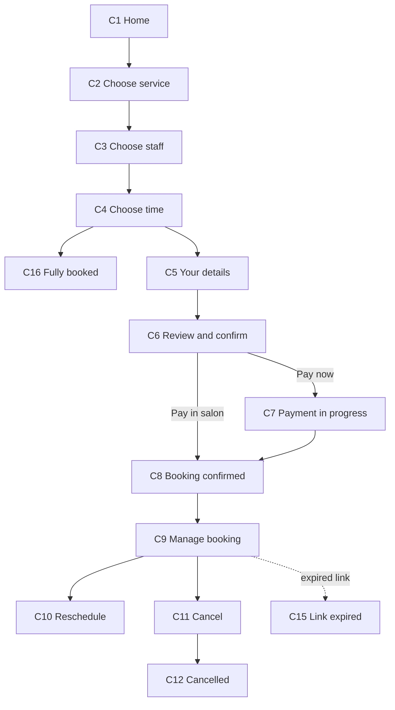
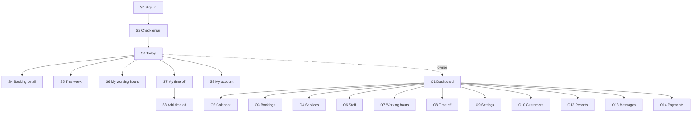

# Screens

This is the complete list of screens for Bellabooking, grouped by who uses them. It is the input for the design work. The design phase draws these first, and Milestones 2 to 5 build them.

For each screen:
- **Shows** is the content on the screen.
- **Actions** is what the user can do, and where it leads.
- **Milestone** is when it is built, from the roadmap in README.md.

Rules that apply everywhere:
- Designed at phone width (375px) first, then desktop.
- Every screen has an empty state and an error state, following the wording in DESIGN.md section 9.
- Anything the owner can configure is editable on the admin screens. Starting values are in [salon-defaults.md](salon-defaults.md).
- Staff see only their own bookings and hours. The owner sees everything.

## Customer screens (public site, no login)

| ID | Screen | Shows | Actions and where they lead | Milestone |
|---|---|---|---|---|
| C1 | Home | Salon name, short intro, "Book now" button, opening hours, contact details | Book now → C2. Footer links → C12, C13 | 2 |
| C2 | Choose service | Active services, grouped by category. Each shows name, duration, price, and payment label ("Pay now" or "Pay in salon") | Select a service → C3 | 2 |
| C3 | Choose staff | Staff who offer the chosen service, with name and photo. "Anyone available" option at the top | Select a person or "anyone available" → C4. Skipped if only one person offers the service | 2 |
| C4 | Choose date and time | Calendar with bookable dates, then the free start times for the chosen day. Service, price and duration stay visible at the top | Select a time → C5. Back → C3 | 2 |
| C5 | Your details | Form: full name, email, phone. Marketing consent checkbox, unticked | Continue → C6. Back → C4 | 2 |
| C6 | Review and confirm | Summary: service, staff, date, time, duration, price. Cancellation rule in plain words | Pay in salon services: confirm → C8. Pay now services: pay → C7. Edit links → C2, C3, C4, C5 | 2 (confirm), 4 (pay) |
| C7 | Payment in progress | "We're confirming your payment." Stays until the payment is confirmed, then goes to C8. Shows a retry message if payment failed | Payment succeeded → C8. Failed → back to C6 with message. Stripe Checkout is an external page | 4 |
| C8 | Booking confirmed | Booking reference, service, staff, date, time, address, price. "Add to calendar" file. Link to manage the booking | Manage booking → C10. Home → C1 | 2 |
| C9 | Manage booking | Opened from the email link. Booking details, cancellation deadline, status | Reschedule → C11. Cancel → C12. If the link is expired or invalid → C15 | 5 |
| C10 | Reschedule | Same calendar and times as C4, for the same service. Current booking shown for reference | Select a new time → C9 with confirmation. The old booking is cancelled only when the new one is confirmed | 5 |
| C11 | Cancel booking | Booking details. Whether a refund applies (inside or outside the free window) | Confirm cancellation → C14. Keep booking → C9 | 5 |
| C12 | Booking cancelled | "Your booking is cancelled." Refund message if applicable. Option to book again | Book again → C1 | 5 |
| C13 | Message preferences | Reminder options: email reminders on or off, SMS on or off. Email confirmations always on | Save → C13 with confirmation. Reached from the SMS and email footers, so it works without login | 5 |
| C14 | Privacy and terms | Privacy notice (what data is kept, how long, how to ask for deletion) and terms | Back to C1 | 2 |
| C15 | Link expired or invalid | "This link has expired. Find your booking by calling us on [number]." Salon phone shown | Home → C1 | 5 |
| C16 | Fully booked | Shown in place of C4 when a service has no free times in the next 60 days. Salon phone number shown. No waiting list in v1 | Back → C2 | 2 |
| C17 | Salon not open | Shown when the salon is closed and the customer tries to book. Next opening time shown | Back → C1 | 2 |

## Staff screens (login required)

Staff sign in with an email link. They see only their own bookings and hours.

| ID | Screen | Shows | Actions and where they lead | Milestone |
|---|---|---|---|---|
| S1 | Sign in | Email field, "Send me a sign-in link" | Submit → S2 (check your email) | 3 |
| S2 | Check your email | Message that a link has been sent, with resend option | Link opened → S3 | 3 |
| S3 | Today | Today's bookings in time order: time, customer first name, service, status. Count of bookings, and time off if any | Tap a booking → S4. Switch to week → S5. Menu → S6, S7, S9 | 3 |
| S4 | Booking detail | Customer name and phone, service, time, duration, price, payment status, customer notes | Mark completed. Mark no-show. Cancel (with confirmation). All update the list in S3. Back → S3 | 3 |
| S5 | This week | Bookings for the week, grouped by day | Tap a booking → S4. Previous or next week | 3 |
| S6 | My working hours | Weekly grid of start and end times per weekday | Edit a day → save. Changes apply from a chosen date forward | 3 |
| S7 | My time off | List of upcoming time off, with bookings affected | Add time off → S8 | 3 |
| S8 | Add time off | Date range, reason, and the list of bookings that fall inside it | Save. Affected bookings must be moved or cancelled by the owner, so the screen says so | 3 |
| S9 | My account | Name, sign out | Sign out → S1 | 3 |

## Owner screens (login required)

The owner has all staff screens for everyone, plus the screens below. The owner's home screen is O1, not S3.

| ID | Screen | Shows | Actions and where they lead | Milestone |
|---|---|---|---|---|
| O1 | Dashboard | Setup checklist until the basics are done. Today's count of bookings. Alerts: failed reminders, services with no staff, staff without hours | Each alert → the screen that fixes it. Checklist items → O4, O9, O11 | 3 |
| O2 | Calendar | All staff in columns (day view) or all staff across the week. Bookings coloured by status | Tap a booking → O5. Filter by staff. Switch day and week view | 3 |
| O3 | Bookings | Searchable, filterable list: date range, status, staff, service. Columns: date, time, customer, service, staff, status, price | Tap a row → O5. New booking for a customer → O5 (create) | 3 |
| O4 | Services | Table of all services: name, duration, buffer, price, payment mode, active, order | Edit → O4a. Add service → O4a. Reorder. Hide or show | 3 |
| O4a | Service edit | Form: name, description, duration, buffer, price, payment mode, active or hidden | Save → O4. Remove (only if no bookings, otherwise hide instead) | 3 |
| O5 | Booking detail (owner) | Everything in S4, plus full customer record and booking history | Mark completed, no-show, cancel. Reschedule for the customer → O2 flow. Refund (paid bookings only, with confirmation). Add internal note | 3 (status), 4 (refund) |
| O6 | Staff | List of staff: name, active or inactive, services offered | Edit → O6a. Add staff → O6a | 3 |
| O6a | Staff edit | Name, active or inactive, services checklist, link to hours and time off | Save → O6. Deactivate (keeps past bookings) | 3 |
| O7 | Working hours (all staff) | Weekly grid per staff member, one tab or column each | Edit a cell → save. Copy a day to others | 3 |
| O8 | Time off | Whole-salon closures and per-person time off, with affected bookings | Add closure (applies to everyone) → affected bookings list. Add time off for one person | 3 |
| O9 | Settings | Sections: Business details, Opening hours, Booking rules, Reminders | Each section saves on its own. Reminder timings and on or off. Opening hours link to O7 | 3 |
| O10 | Customers | Searchable list: name, email, phone, last visit, number of bookings | Tap → O11 | 3 |
| O11 | Customer detail | Contact details, marketing consent, booking history, notes | Edit details. Delete or anonymise (with confirmation, following the privacy default) | 3 |
| O12 | Reports | Bookings per week, revenue per week, no-show rate, cancellations. Date range picker | Export CSV (optional, see open questions) | 3 |
| O13 | Messages | Log of sent reminders and confirmations. Failed sends with reason | Retry a failed send. Filter by status | 5 |
| O14 | Payments | Online payments and refunds. Amounts, status, booking link | Tap → O5 | 4 |

## System screens

| ID | Screen | Shows | Milestone |
|---|---|---|---|
| X1 | Page not found | "We couldn't find that page." Link home | 2 |
| X2 | Something went wrong | Friendly message, what to try next, salon phone. Error reference for support | 2 |
| X3 | Under maintenance | Message and salon phone. Used during deployments if needed | 6 |

## How the customer flow connects

## How the staff and owner flow connects

## Screen count

| Group | Screens |
|---|---|
| Customer | 17 |
| Staff | 9 |
| Owner | 16 (includes the two edit screens O4a and O6a) |
| System | 3 |
| **Total** | **45** |

## Open points for the design phase

- **Calendar on phones:** the owner's calendar (O2) needs a day view that works at 375px. Week view may be desktop only.
- **Staff photos:** C3 shows photos. Until the salon supplies them, use initials on a neutral background.
- **Export:** O12 export to CSV is optional. Decide before the reports are designed.
- **Customer name on the staff screens:** S3 and S4 show first name and surname. Confirm whether the salon wants first name only on the day view for privacy.
